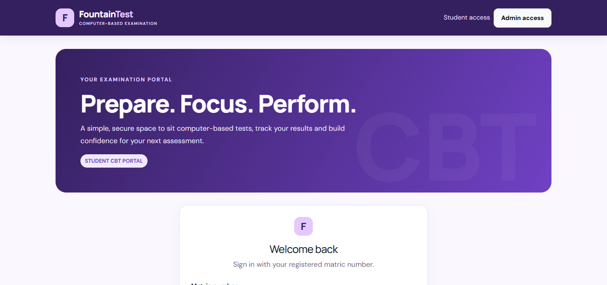
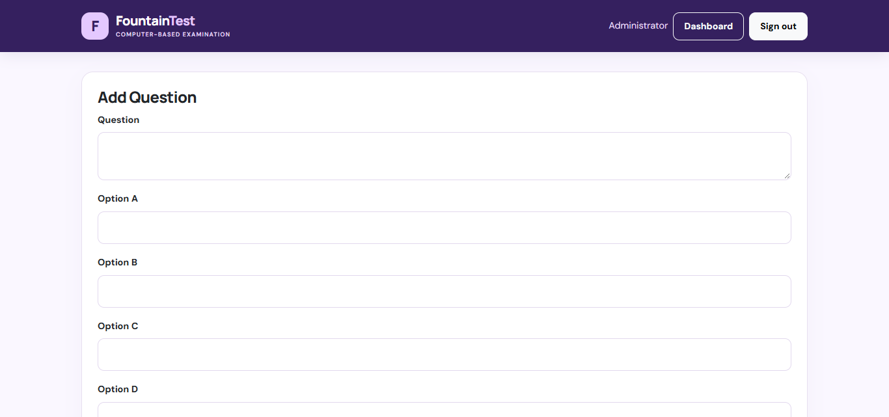

# CbtHub: Computer-Based Test Platform

A simple computer-based testing (CBT) platform for schools and universities that still run tests on paper. Students sign in with their matric number, take a timed multiple-choice test drawn from a question bank, and track their results. Administrators add questions and review results.

The interface is branded **FountainTest**. CbtHub is a **concept project** I built to pitch to schools and universities.

**Live demo:** https://cbthub.infinityfreeapp.com



## The problem

Schools without a computer-based testing system rely on paper tests, which are slow to set, supervise, mark and record. Students also get little chance to practise in a timed, exam-like setting before the real assessment.

## What it does

**Students**
- Register and sign in with a matric number
- Dashboard showing exams completed, best score and last attempt
- Timed test (20 minutes) with a live countdown, a progress tracker and a warning about unanswered questions
- A random set of up to 10 multiple-choice questions drawn from the question bank
- Result page after submitting, and an answer review page

**Administrators**
- Separate admin sign-in
- Add and delete questions in the question bank
- View all student results
- Dashboard with summary figures



## Tech stack

PHP (mysqli with prepared statements), MySQL, JavaScript, HTML5 and Bootstrap 5.

## Security measures in the code

- Passwords stored as hashes (`password_hash`) and checked with `password_verify`
- Prepared statements for database queries
- Output escaped with `htmlspecialchars`
- Session ID regenerated on sign-in
- Exam submissions protected by a per-exam token checked with `hash_equals`
- Pages for students and admins redirect to sign-in when there is no session

## Run it locally (XAMPP or WAMP)

1. Copy this folder into `htdocs/` (XAMPP) or `www/` (WAMP), for example as `cbthub`.
2. In phpMyAdmin, create a database called `online_exam` and import `online_exam.sql`.
3. Copy `Includes/dbcon.sample.php` to `Includes/dbcon.php` and set your database details. `Includes/dbcon.php` is ignored by Git, so your credentials stay private.
4. Create the first admin account. Generate a password hash in PHP, for example from a terminal:
   ```
   php -r "echo password_hash('ChooseAStrongPassword', PASSWORD_DEFAULT);"
   ```
   Then run this in phpMyAdmin, pasting your hash:
   ```sql
   INSERT INTO admin (username, password) VALUES ('admin', 'PASTE_YOUR_HASH_HERE');
   ```
5. Open `http://localhost/cbthub`. Students register themselves on the register page. Sign in to `/admin` with your admin account to add questions.

## Project structure

```
index.php, register.php   Student sign-in and registration
dashboard.php             Student dashboard
exam.php, submit.php      Taking and submitting a test
result.php                Result after a test
view_answer.php           Answer review
admin/                    Admin sign-in, dashboard, questions and results
Includes/                 Database connection (sample), header and footer
style.css, jsfile.js      Styling and the exam timer
online_exam.sql           Database schema for a fresh install
```

## Known limitations

- The countdown runs in the browser only. It is not a tamper-proof, server-enforced timer, so this is not ready for high-stakes exams as it stands.
- The answer review page shows the question bank and correct answers to any signed-in student. It would need a rule that limits it to students who have finished an attempt.
- Built as a concept project and not reviewed for production use.

## Author

**Balogun Fawaz Opeyemi**, B.Sc. Computer Science (First Class), Fountain University, Osogbo.

## Status and licence

Shared for viewing and evaluation. No open-source licence has been granted yet, so all rights are reserved.
